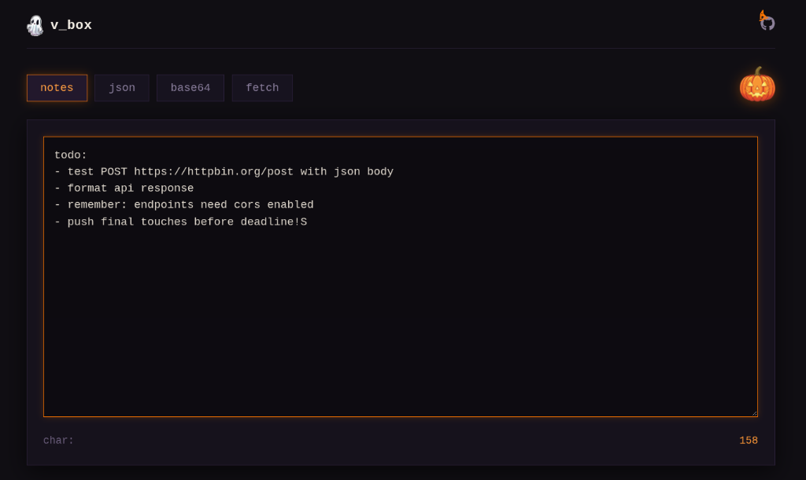
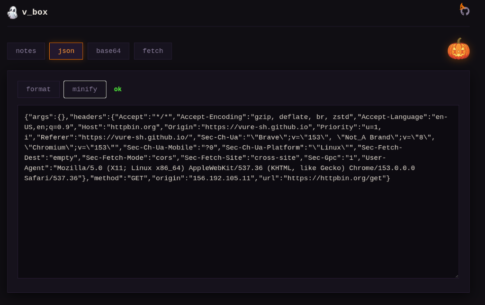
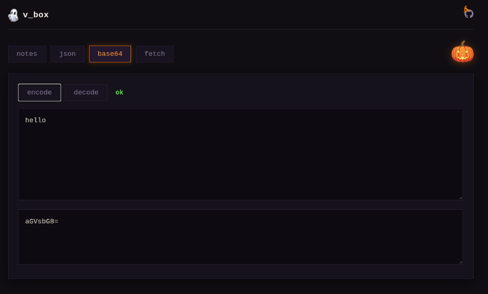
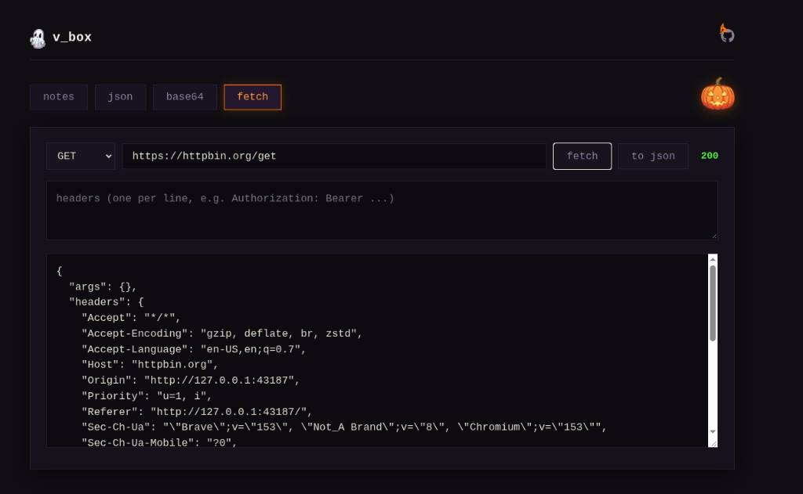

# vure_box

a small tool for things i use every day. made this for hackclub #3am because postman is way too slow when all you want to do is test a quick link or clean up some json at night.

### screenshots

| notes | json |
| :---: | :---: |
|  |  |
| **base64** | **fetch** |
|  |  |

### live site
https://vure-sh.github.io/vure_box/

---

### features

- **notes**:
  - write down quick thoughts or code
  - saves automatically in your browser so you don't lose anything if you close the tab
  - has a character counter at the bottom

- **json**:
  - paste messy json
  - `format`: makes it neat and easy to read
  - `minify`: squishes it into one line
  - says `ok` if it's good, or `bad json` if there's a typo or if not json

- **base64**:
  - turn text into base64 and back
  - uses built-in browser functions (`btoa` and `atob`)
  - runs completely on your computer, nothing gets sent to a server

- **fetch**:
  - test api links (`GET`, `POST`, `PUT`, `DELETE`) right in your browser
  - add headers (one per line) or a body for POST/PUT
  - shows the response status (like `200`) and the output
  - click **to json** to send the response straight to the json tab to clean it up

---

### why did fetch say err? (cors)
since this runs directly in your browser, some apis block requests coming from other websites (cors).
- if the api blocks it, you'll see `err`
- `https://httpbin.org/get` is set by default so you can test right away without issues

---

### tech stack
- pure html, css, and js (no frameworks, no npm, no build steps)
- font awesome for icons

---

### how to run
just download the repo and open `index.html` in your browser. that's it.

---

### dev notes & tooling
- coded manually in vscode (html/css/vanilla js)
- used gemini as a rubber duck to debug some fetch header parsing and look up base64 functions (`btoa`/`atob`)

---

### who is json?
a guy that gets sent with each call //sorry for the bad joke lol